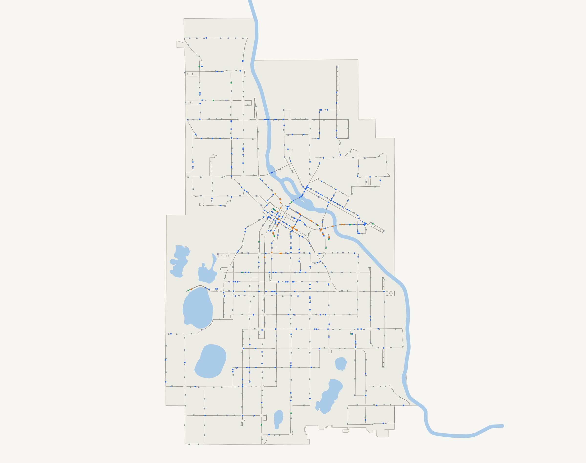

# Speed, comfort and route directness

## What real systems do

Built PRT and small automated systems run at 11–17 m/s (25–38 mph):

| System | Top speed | Notes |
|---|---|---|
| Morgantown PRT (1975–) | 48 km/h (30 mph) | Gentle 0.6–0.7 m/s² acceleration |
| ULTra, Heathrow | 40 km/h (25 mph) | 1.25 m/s² acceleration, 2.5 m/s² emergency braking |
| 2getthere (Rivium, Masdar) | 25–32 km/h | |
| Vectus / SkyCube, Suncheon | 60–70 km/h design (sources disagree); about 40 km/h observed | |
| Raytheon PRT 2000 (Taxi 2000 design) | 48 km/h (30 mph) | 0.25 g service, 0.25 g/s jerk, 0.25 g lateral with up to 6° banking, 18 m minimum radius |
| SkyWeb Express (Taxi 2000) | 32–80 km/h depending on alignment | 0.5 s headways |
| Cabintaxi (Germany, test track) | 36 km/h | Vehicles ran above and below the same beam |
| Glydways | 50 km/h (31 mph) | |
| Wuppertal Schwebebahn (suspended) | 60 km/h limit | About 27 km/h average |
| H-Bahn Dortmund (suspended) | 65 km/h (vendor figure) | |

J. Edward Anderson, the main PRT design theorist, considered about 13.4 m/s
(30 mph) typical for urban lines and 18–20 m/s only along freeways. His cost
studies came out at lower speeds than he expected. Higher speed means
longer station ramps, stiffer (costlier) guideway, and longer safe headways.

## Comfort limits

From ASCE 21 (Automated People Mover Standards, 2008) and Anderson:

| | Seated | Standing |
|---|---|---|
| Sideways (felt) | 0.25 g (2.45 m/s²); Anderson designs to 0.2 g | 0.10 g |
| Speeding up / slowing, normal service | up to 0.35 g; 0.2 g is a conservative design value | 0.16 g |
| Jerk | 0.25 g/s | 0.04–0.10 g/s |
| Emergency braking | up to 0.6 g; Anderson uses 0.4 g ("0.5 g is enough to throw a person into the windshield") | 0.32 g |

**Banking and swinging.** Banking the guideway lets a curve use more
acceleration than riders feel. Anderson finds a top-supported vehicle with
about 10° of bank and 0.2 g felt needs the same curve radius as a
suspended cabin swinging about 21° with nothing felt sideways. So
"suspended allows tighter curves" is really about how much swing is
allowed. Swing has to be damped, and roll combined with sideways force is
what causes motion sickness. Suspended systems also cost more in posts and
foundations, and switching is harder. Their clear advantage in Minneapolis is
that snow and ice stay off the running surfaces.

**Transition spirals** matter at these scales: about 15–25 m from jerk
limits alone, and possibly 60–100 m if the cabin's roll or swing must be
eased in. A swinging cabin's natural period is about 2–2.5 s, so a shorter
spiral leaves it oscillating. The simulator doesn't model spirals yet.

**Presets now in the simulator** (`comfort=`):

| Preset | Usable cornering | Speeding up / slowing |
|---|---|---|
| standing | 0.98 m/s² | 1.27 m/s² |
| flat (seated, no banking) | 1.96 m/s² | 1.96 m/s² |
| rail (seated, about 6° banking) | 3.0 m/s² | 1.96 m/s² |
| suspended (seated, damped swing) | 3.7 m/s² | 1.96 m/s² |

The earlier 1.2 m/s² "rail" figure was effectively the standing-rider
limit. With seated, banked values, rail and suspended perform about the
same in simulation.

Sources: [ASCE 21.2-08](https://archive.org/stream/gov.law.asce.21.2.2008/asce.21.2.2008_djvu.txt),
[Anderson 2016, Contributions to the Development of PRT](https://www.inist.org/library/2016.Anderson.Contributions%20to%20the%20Development%20of%20PRT-Vol%20I.ATRA%20CPRT.pdf),
[PRT 2000 characteristics](https://staff.washington.edu/jbs/itrans/prt2000-system-characteristics.htm),
[ATRA system comparison](https://www.advancedtransit.org/advanced-transit/prt-characteristics/),
[Cabintaxi](https://faculty.washington.edu/jbs/itrans/cabin.htm),
[SkyWeb Express feasibility study](https://faculty.washington.edu/jbs/itrans/big/SWEfeasibilitystudy.pdf),
[Morgantown (US DOT)](https://rosap.ntl.bts.gov/view/dot/298/dot_298_DS1.pdf),
[Wuppertal Schwebebahn](https://en.wikipedia.org/wiki/Wuppertal_Schwebebahn),
[Förstberg 2000, tilting trains and motion sickness](https://www.diva-portal.org/smash/get/diva2:8728/FULLTEXT01.pdf),
[suspended monorail dynamics](https://link.springer.com/article/10.1007/s40534-025-00403-6),
[Glydways](https://electrek.co/?p=455512).

**Not verified:** Chiba monorail top speed, the normative text of EN 13803 and
EN 12299, current ASCE 21-21 values (the figures above are the 2008
edition), and SkyTran's speed claims.

## Faster lines

The network builder now takes a design speed (`--vMain=` m/s):

- **Ramps and stations scale with speed:** turn ramps and station lanes
  are long enough to slow down and speed up at 0.2 g.
- **Curvy streets set their own limits:** each main-line piece of up to
  150 m records its tightest curve, and the simulator caps speed there
  from the comfort preset.

| Design speed | Station sites | People + jobs within ¼ mile | Average walk each end |
|---|---|---|---|
| 15 m/s (34 mph) | 310 | 69% | 473 m |
| 20 m/s (45 mph) | 268 | 54% | 535 m |
| 25 m/s (56 mph) | 194 | 36% | 672 m |

Door to door (median minutes, 4–5 PM, 7,500 trips/hour). PRT now uses each
network's actual average walk:

| Distance | 34 mph rail | 34 mph susp. | 45 mph rail | 45 mph susp. | 56 mph susp. | Car | Transit | Bike |
|---|---|---|---|---|---|---|---|---|
| 1–2 km | 19.6 | 19.6 | 21.8 | 21.1 | 26.3 | 7 | 21 | 14 |
| 2–3 km | 22.2 | 22.0 | 22.8 | 22.1 | 27.1 | 11 | 20 | 18 |
| 3–5 km | 24.5 | 24.4 | 25.4 | 24.5 | 30.3 | 13 | 30 | 14 |
| 5–8 km | 29.0 | 29.4 | 28.6 | 27.9 | 35.0 | 17 | 37 | 27 |
| 8–15 km | 35.0 | 36.7 | 37.2 | 33.2 | 35.3 | 21 | 47 | – |

- **Faster lines don't pay at this scale.** At 45 mph rides are 1–3
  minutes shorter on longer trips, but fewer stations fit and walks get
  longer. At 56 mph access collapses. Speed could still pay on a few long
  express links without stations (along freeways, as Anderson suggests).
- **The 56 mph runs had collisions** (216–549). The merge controller hasn't
  been tuned for that speed (its look-ahead is too short), so treat that row
  as indicative.
- **Walking is now the biggest part of the trip.** With the honest average
  walk, about 12 of the 24 minutes on a 3–5 km trip are on foot. Earlier
  tables assumed a 280 m walk and understated door-to-door times by about
  5 minutes.

## Route directness

Median guideway route ÷ straight-line distance between station pairs:

| Layout | 1–2 km | 2–4 km | 4–8 km | 8–20 km |
|---|---|---|---|---|
| Idealized half-mile grid, one-way | 2.78 | 1.84 | 1.49 | 1.39 |
| Twin beams on streets (v2) | 2.80 | 2.01 | 1.78 | 1.44 |
| One-way, corridor greedy (v3) | 3.02 | 2.58 | 2.04 | 1.72 |
| One-way lattice, long lines (current) | 3.13 | 2.34 | 1.85 | 1.72 |

- **Short trips are roundabout in every PRT layout,** even with twin
  beams. Vehicles can only turn around at junctions, so a 1–2 km trip
  typically covers nearly three times its straight-line distance.
- **The current layout** is a street-snapped lattice: through streets of at
  least 2.5 km in two families (north–south and east–west, plus downtown's
  rotated grid), about half a mile apart, closer where dense. Neighbouring
  lines alternate direction where possible.
- **What didn't work:** adding one-way shortcuts after directions were set
  didn't improve directness.
- **What would:** closing the rest of the gap to the idealized grid needs
  more regular, complete lines, and that's limited by where Minneapolis's
  long through streets actually run.

## Denser stations and lines

Walking was the biggest part of door-to-door time, so I tested what
denser stations buy. All runs are suspended comfort, 4–5 PM, 7,500
trips/hour, with about 3,100 vehicles each.

**The University was a gap.** Almost half of all walking came from the 14%
of people and jobs more than 800 m from a station. The largest cluster was
the University of Minnesota (Dinkytown, Stadium Village, Prospect Park),
about 74,000 people and jobs. Those streets, like downtown's and the
riverfront neighbourhoods', follow a grid rotated to about 60°, and the
lattice only recognized that grid inside a circle around downtown. Now
each line is classified by its own bearing, and each place is served by
the grid its nearby streets follow. A gap-filling pass also adds up to
25 km of street pieces that reach people still far from any line.

| Version | Street miles | Station sites | Avg walk | Within ¼ mi | Within ½ mi | Route ÷ straight (median) |
|---|---|---|---|---|---|---|
| Previous (800 m lines, 300 m min station gap) | 167 | 310 | 473 m | 69% | 86% | 1.88 |
| University fixed + gap fill | 190 | 338 | 329 m | 81% | 96% | 2.03 |
| …and stations 200 m apart | 190 | 387 | 319 m | 83% | 96% | 2.04 |
| …lines 600 m apart, stations 200 m apart (**new default**) | 193 | 390 | 329 m | 80% | 96% | 1.84 |
| …lines 600 m apart, stations 300 m apart | 193 | 333 | 340 m | 78% | 96% | 1.83 |
| …lines 400 m apart | 217 | 358 | 325 m | 81% | 97% | 1.86 |

Door to door, median minutes:

| Distance | Previous | New default | Car | Transit | Bike |
|---|---|---|---|---|---|
| 1–2 km | 19.6 | 14.9 | 7 | 21 | 14 |
| 2–3 km | 22.0 | 16.4 | 11 | 20 | 18 |
| 3–5 km | 24.4 | 19.2 | 13 | 30 | 14 |
| 5–8 km | 29.4 | 22.6 | 17 | 37 | 27 |
| 8–15 km | 36.7 | 27.6 | 21 | 47 | – |

- **Line coverage was what mattered.** Reaching the University and filling
  the gaps cut the average walk from 473 to 329 m.
- **Lines 600 m apart beat 800 m:** shorter walks and more direct routes
  for about 26 more street miles.
- **400 m apart is worse.** It adds 24 more miles plus more crossings and
  merges, and with the same fleet spread over more track, waits and rides
  get longer.
- **Packing stations closer on the same lines barely changes the walk.**
- **Net effect:** about 5–7 minutes faster than before at every distance.
  PRT now clearly beats transit, is about even with biking up to 5 km and
  faster beyond, and runs 5–8 minutes slower than driving.

