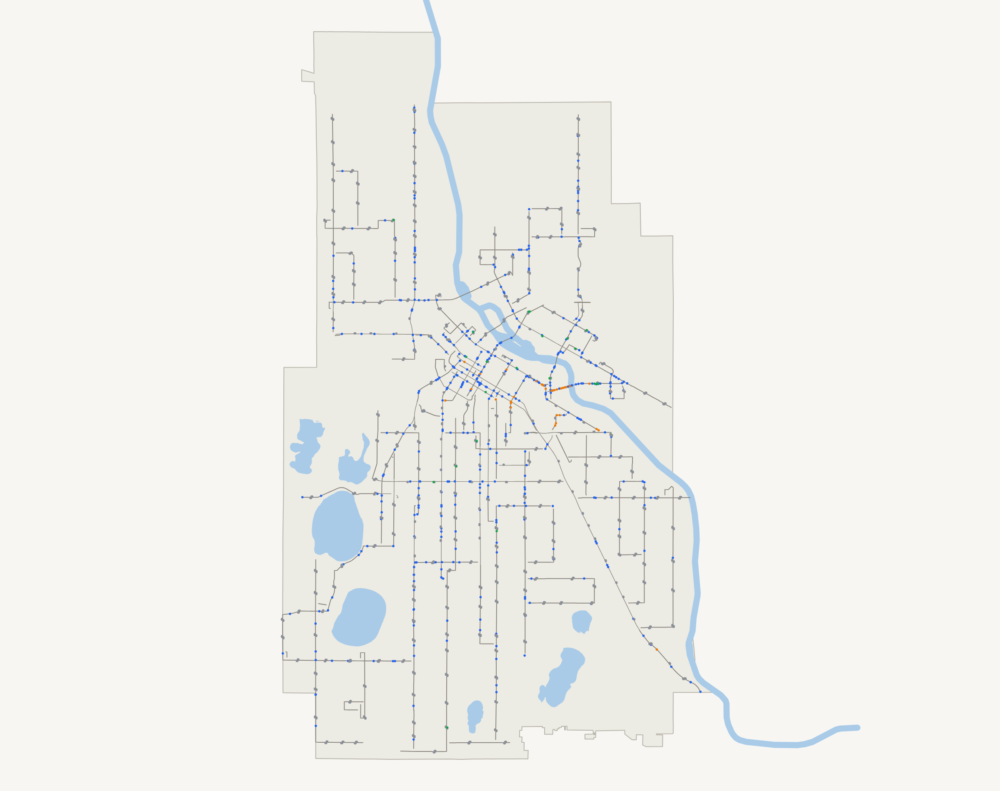
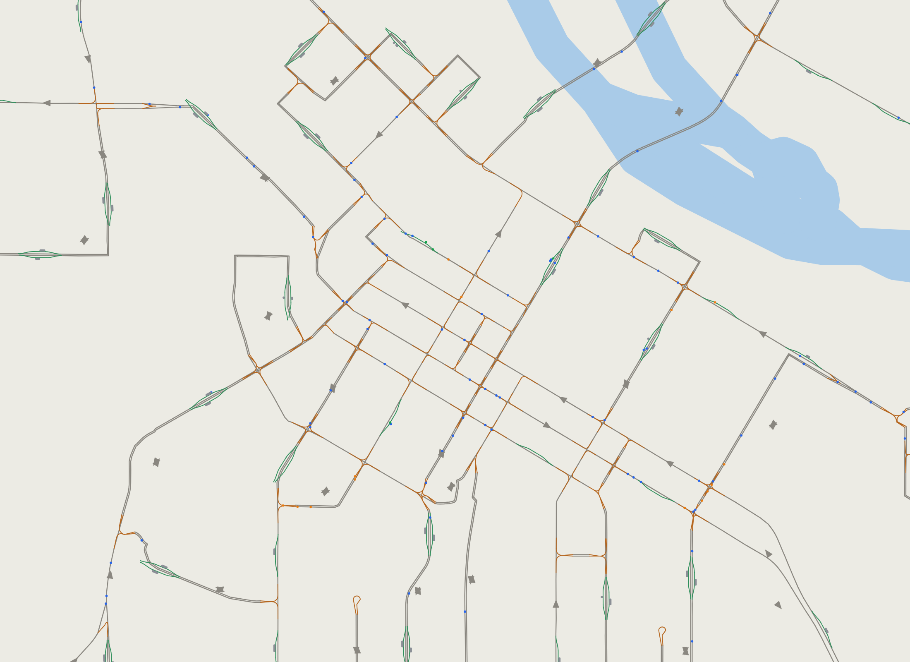
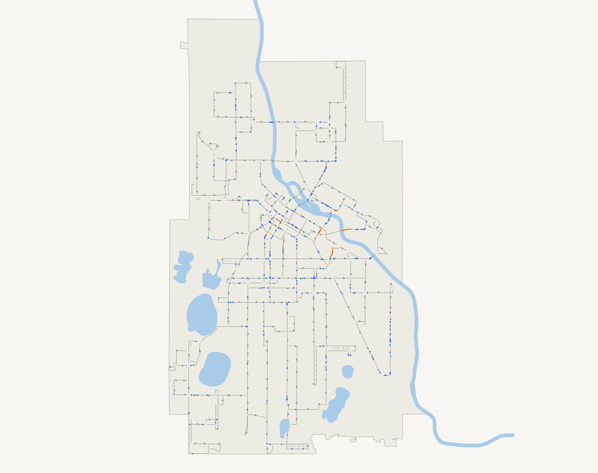

# Minneapolis on real streets (versions 2 and 3)

The half-mile grid (version 1, [minneapolis-v1.md](minneapolis-v1.md)) was
a way to get the simulator running. This version lays the guideway over
actual Minneapolis streets, picked automatically to reach the most people and
jobs per mile of guideway.

## Rules

- **Elevated over streets.** The guideway can follow any public street:
  arterials, collectors, and local through-streets that run at least 2.5 km
  (32nd St is the kind of scale in mind). Local streets carry a 15% cost
  penalty. Freeways, ramps, alleys and parkways are excluded. So is the
  Midtown Greenway, since an elevated line doesn't suit its trench.
- **River crossings only on existing bridges.** The guideway can only go
  where a street goes, so it crosses the river only where a street bridge
  already does. The current layout uses 6 bridges.
- **Direction follows traffic.** A street that's one-way for cars gets one
  one-way beam in the same direction, so downtown's one-way pairs become
  guideway pairs. Two-way streets get twin beams on shared columns. A one-way
  piece that would strand vehicles is upgraded to twin.
- **Junctions.** Grade-separated, with a ramp for every turn. Each ramp has a
  slow-down lane, a curve sized by the turning angle, and a speed-up lane. A
  line that ends gets a turnaround loop.
- **Stations.** Off the line, with 10–16 sawtooth bays each, at least 300 m
  apart. They're placed one at a time where they reach the most people and
  jobs not yet within walking distance, so spacing is tight where it's dense
  and wide where it isn't. Each spot is checked against county parcel
  records for a plausible site nearby: vacant land, commercial or industrial
  land with no building (often parking), lightly built commercial property,
  or public land other than parks. 220 of 287 sites have one. This is only a
  plausibility check, not real site selection.
- **A quarter mile is a goal, not a rule.** Coverage is reported at a
  quarter, a third and half a mile.

## How the layout is chosen

1. **Candidates:** street pieces between intersections, from Hennepin
   County's centerline data.
2. **Corridors:** chosen about a mile of one street at a time, starting from
   the busiest and growing outward. Each step adds the connected stretch that
   brings the most new people and jobs within 300 m per km of guideway, with
   a bonus for continuing along the same street. It stops at a budget of
   170 km of street.
3. **Loops:** dead ends are joined to the rest of the network by the shortest
   street route, up to 3 km, preferring to carry straight on.
4. **Shortcuts:** sample trips between busy points and compare the guideway
   route with the street route. Where the guideway is at least 30% longer,
   add the street route, up to 30 km of extra street in total.
5. **Stations:** greedy placement, as above.

`npm run build:network` rebuilds the network and both demand tables. Inputs:
`scripts/fetch-streets.mjs` and `scripts/fetch-parcels.mjs` (Hennepin County
GIS), plus the census and survey data in [data-sources.md](data-sources.md).

## The result

| | |
|---|---|
| Streets with guideway | 138 miles (twin 111, one-way 27) |
| Beam length (both directions) | 249 miles |
| Station sites | 287 (528 one-direction stations) |
| …with a plausible site nearby | 220 |
| River bridges used | 6 |
| Turn ramps / line-end turnarounds | 797 / 18 |
| People + jobs within a ¼ mile walk | 76% |
| …within ⅓ mile / ½ mile | 86% / 91% |

Walking distance is approximated as straight-line × 1.25.

## Simulation: 4–5 PM, travel-survey demand, 0.5 s headway

| Trips/hour | Share of peak trips | Fleet | Average wait | Result |
|---|---|---|---|---|
| 1,500 | 2% | 1,584 | 37 s | Easy |
| 5,000 | 7% | 2,112 | 64 s | Works |
| 7,500 | 10% | 2,640 | 70 s | Works, no stations overflowing |
| 12,000 | 16% | 3,696 | 95 s | Strained but flowing; some stations overflow |

At 12,000 trips/hour the half-mile grid gridlocked. The street network
copes better, mostly because its lines and stations follow where the people
and jobs are.

## Door-to-door times compared with how people travel now

Median minutes by straight-line trip distance, at 7,500 trips/hour. PRT
includes about 3 minutes of walking at each end, plus the wait and 15 s each
to board and get off. The other modes are the travel survey's reported
door-to-door times for trips inside Minneapolis.

| Distance | PRT | of which riding | Car | Transit | Bike | Ride-hail |
|---|---|---|---|---|---|---|
| 1–2 km | 14 | 5 | 7 | 21 | 14 | 7 |
| 2–3 km | 16 | 7 | 11 | 20 | 18 | 8 |
| 3–5 km | 18 | 9 | 13 | 30 | 14 | 25* |
| 5–8 km | 21 | 13 | 17 | 37 | 27 | 12* |
| 8–15 km | 24 | 16 | 21 | 47 | 96* | – |

\* Few survey trips in these cells.

- **PRT beats transit at every distance**, usually by about half.
- **It's about even with bikes** and beats them on longer trips.
- **It's 4–7 minutes slower than driving.** The time in the vehicle is about
  the same as a car's whole trip; the gap is the walk at each end.
- **Routes are indirect.** The median route is 1.8× the straight-line
  distance, against 1.5× on the grid, because of one-way pieces, missing
  cross-connections and slow turns.

Levers to close the gap with the car:

- denser stations, for shorter walks;
- higher line speed on long straight runs (15 m/s is 34 mph);
- more crosstown lines, for more direct routes;
- faster boarding.

## Version 3: every line one-way

Single beams are thinner and less intrusive than twin guideway, so version 3
uses only one-way lines. Traffic direction on the street doesn't matter; the
guideway can run either way.

**Changes from version 2:**
- **No twin beams.** Every line has a way back: any link whose loss would
  cut the network in two is joined into a loop by the shortest street route
  (up to 3 km), or dropped if there's none. 62 loops were closed this way and
  4.8 km dropped.
- **Directions are optimized.** It starts from a direction for every line
  that keeps everything reachable, then flips lines one at a time whenever
  that shortens demand-weighted travel and keeps everything reachable.
- **Junction costs.** Corridor choice counts a four-way crossing as 0.6 km of
  extra guideway (two levels and two turn ramps), and a three-way junction as
  0.15 km.
- **Freeways** are candidates, at a 30% cost penalty. 6 miles were used.
- **Stations** stay about 155 m or more from any junction (ramp clearance
  plus the station's own length). Curves elsewhere are fine.

**Cost.** The SIKA report (Swedish government, 2003 prices) puts an elevated
twin guideway at about 1.5× the cost of a single one per km, since columns
and foundations are shared ([SIKA](https://issuu.com/simplylovelife/docs/sika_prt_report/71)).
On that basis:

| | Version 2 (mostly twin) | Version 3 (one-way) |
|---|---|---|
| Street miles | 138 | 148 |
| Beam miles | 249 | 148 |
| Cost in single-beam-equivalent miles (about) | ~205 | 148 |
| Station sites / one-direction stations | 287 / 528 | 273 / 273 |
| Junctions: crossings / tees | – | 73 / 230 |
| People + jobs within ¼ / ⅓ / ½ mile walk | 76 / 86 / 91% | 76 / 84 / 89% |
| Median route vs straight line | 1.77× | 2.06× |

**Door-to-door times**, median minutes at 7,500 trips/hour, 4–5 PM:

| Distance | One-way | Twin (v2) | Car | Transit | Bike |
|---|---|---|---|---|---|
| 1–2 km | 14.5 | 14 | 7 | 21 | 14 |
| 2–3 km | 16.4 | 16 | 11 | 20 | 18 |
| 3–5 km | 18.8 | 18 | 13 | 30 | 14 |
| 5–8 km | 23.2 | 21 | 17 | 37 | 27 |
| 8–15 km | 27.0 | 24 | 21 | 47 | – |

The one-way network costs roughly 30% less, and trips take 0–3 minutes
longer, mostly on longer trips. It carries 7,500 trips/hour comfortably. At
12,000 it breaks down, and the merge controller's deadlock-breaking lets
vehicles collide. That's a known simulator weakness, not a design result.
